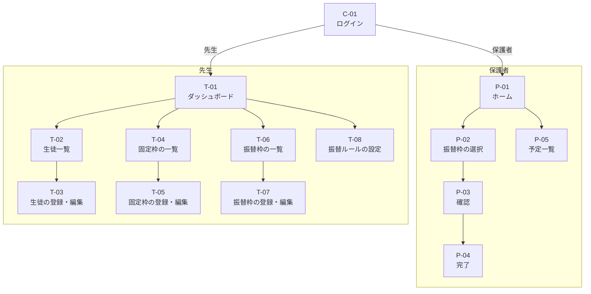
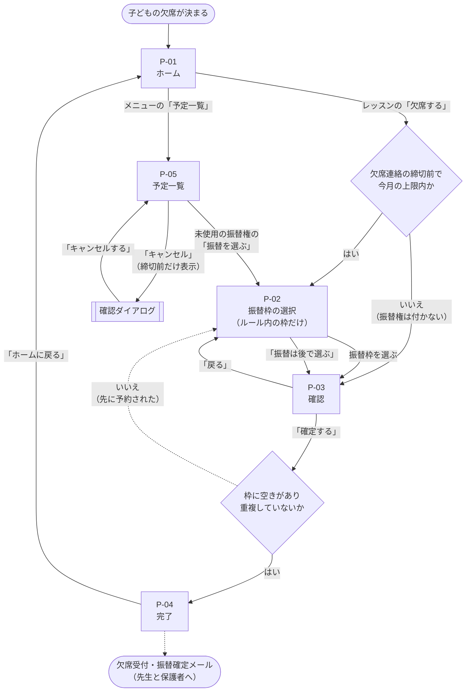
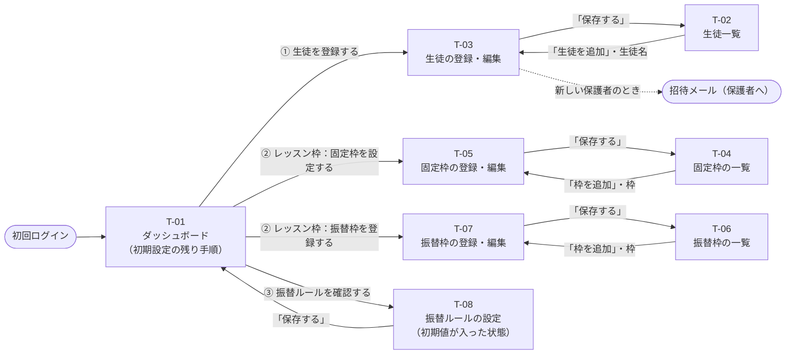
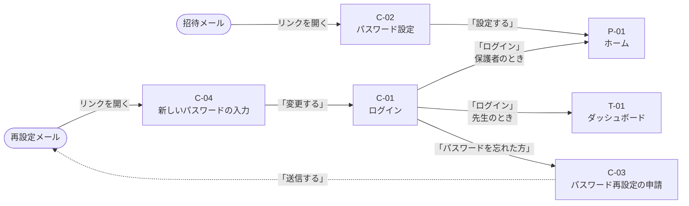
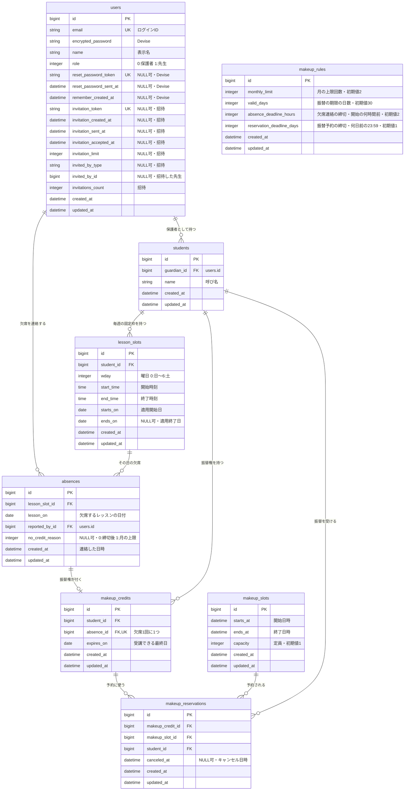

# ふりかえ帳（仮）― 個人ピアノ教室のための振替レッスン管理アプリ

> 保護者が欠席を伝えたその場で、教室のルールに合った振替枠を選んで予約まで終えられる。
> 先生は振替の調整と回数の数え直しから解放され、レッスンに集中できる。

> [!NOTE]
> このREADMEは、開発前の企画書も兼ねています。開発の進み具合に合わせて更新していきます。
> 想定ユーザーと、開発のきっかけになったエピソードは、**ポートフォリオ用に設定した架空の事例**です（実在の教室・人物ではありません）。

---

## 目次

1. [サービス概要](#1-サービス概要)
2. [利用イメージ](#2-利用イメージ)
3. [このアイデアはどこから生まれたか](#3-このアイデアはどこから生まれたか)
4. [課題の整理](#4-課題の整理)
5. [想定ユーザー](#5-想定ユーザー)
6. [既存サービスとの比較](#6-既存サービスとの比較)
7. [このサービスで提供したい価値](#7-このサービスで提供したい価値)
8. [機能一覧（MVP／本リリース）](#8-機能一覧mvp本リリース)
9. [懸念点とその対策](#9-懸念点とその対策)
10. [今後の展開](#10-今後の展開)
11. [技術スタック](#11-技術スタック)
12. [設計資料](#12-設計資料)
13. [ローカル環境の構築](#13-ローカル環境の構築)
14. [開発の進め方](#14-開発の進め方)

---

## 1. サービス概要

**ふりかえ帳**は、先生が1人で運営する月謝制のピアノ教室向けの、振替レッスン管理アプリです。

| | |
|---|---|
| **誰の** | 生徒20〜30人ほどの教室を1人で運営するピアノの先生と、生徒の保護者 |
| **どんな課題を** | 欠席連絡から振替日の決定までの、LINEでのやり取り。振替回数の手作業での管理 |
| **どう解決するか** | 教室の振替ルール（月○回まで・○日以内など）をアプリが自動で確認し、ルールの範囲内の枠だけを保護者に表示する。保護者はその場で振替を確定でき、先生の承認や日程調整は必要ない |

---

## 2. 利用イメージ

**ある平日の朝7時。** 小学2年生の娘が熱を出し、今日16時のピアノレッスンを休むことになった保護者の場合です。

| # | 誰が | 何をする | 以前のやり方 |
|---|---|---|---|
| 1 | 保護者 | スマホで「ふりかえ帳」を開き、今日のレッスンの「欠席する」を押す | 先生にLINEで連絡し、返信を待つ |
| 2 | アプリ | 今月の振替残り回数と、**ルール内で予約できる振替枠だけ**を表示する | 先生が空き時間を探し、候補日をLINEで送る |
| 3 | 保護者 | 都合のよい枠（例：来週木曜17時）を選んで確定する（ここまで約1分） | 候補日のやり取りが何往復も続く |
| 4 | アプリ | 先生と保護者に「欠席受付」と「振替確定」のメールを送る | 先生が紙のノートに書き込む |
| 5 | 先生 | レッスンの合間に、管理画面で今週の欠席・振替の一覧を確認する | 毎月末にノートを見返し、回数を数え直す |

**先生がすることは、最初の設定（生徒の登録・毎週のレッスン枠・振替ルール）と、一覧の確認だけ**です。

---

## 3. このアイデアはどこから生まれたか

### 3-1. きっかけとなったエピソード

自宅でピアノ教室を営む知人（想定）から、こんな話を聞きました。

> 「レッスン中にスマホが何度も鳴る。見ると『今日休みます、振替いつにできますか？』というLINE。
> レッスンの合間に空き時間を探して候補を送るけれど、返事が来る頃には別の子がその枠を埋めていることもある。
> 振替の残り回数は紙のノートで管理していて、月末に数え直すと合わないことがある。
> 本当は生徒の練習の様子を考える時間に使いたいのに、事務のやり取りでいつも疲れてしまう。」

この話を聞いたとき、子どもの頃の記憶がよみがえりました。
小学生の頃、私もピアノ教室に通っていて、熱を出してレッスンを休むたびに、母が夜に先生へ電話をかけていました。
「何度もすみません」と頭を下げながら振替の日を相談する母の姿と、電話の向こうで手帳をめくって空き時間を探してくれる先生の様子を、なんとなく覚えています。

20年以上たった今も、電話がLINEに変わっただけで、**先生と保護者が気を遣い合いながら調整している構造は変わっていない**。
生徒に向き合うための時間が、欠席と振替の調整に削られていることに違和感を持ちました。

### 3-2. なぜそれが「気になった」のか

本業でAWSとRuby on Railsを使った開発に携わる中で、「人が手作業で繰り返している確認や数え直しは、仕組みで減らせる」ことを実感してきました。
一方で、世の中の業務システムの多くは、多くの事業者に対応するために多機能になっており、**1人で運営する小さな教室には大きすぎる**と感じています。
「大きな仕組みを導入する」のではなく、「1人の困りごとにぴったり合う、小さな仕組みを作る」ことに価値を感じているため、このテーマを選びました。

もう1つの理由は、私自身が「人に何度もお願いをするのが苦手」な性格だからです。
仕事でも、確認や依頼のために相手の手を止めてしまうことに、いつも申し訳なさを感じてきました。
母が先生に頭を下げていた姿が記憶に残っているのも、同じ気持ちを感じ取っていたからだと思います。
「お願いしなくても済む仕組み」があれば、先生も保護者も気を遣わずに済む。その状態を自分の技術で作りたいと考えました。

---

## 4. 課題の整理

### 4-1. 表に見えている困りごと

- 欠席連絡と振替日の調整が、LINEでの何往復ものやり取りになる
- 振替の残り回数を紙で管理しているため、数え間違いが起きる

### 4-2. 本当に解決したい課題

| | 問い | 答え |
|---|---|---|
| なぜ？① | なぜLINEのやり取りが困るのか | レッスン中や家事の合間に返信を求められ、先生の時間と集中が細切れになるから |
| なぜ？② | なぜ先生が毎回対応しなければならないのか | 振替のルール（回数・期限）と空き枠を知っているのが先生だけで、保護者は自分で判断できないから |
| なぜ？③ | なぜ先生だけが知っている状態なのか | ルールが先生の頭とノートの中にしかなく、保護者から見える形になっていないから |

**→ 本当に解決したい課題：振替の判断を先生1人が抱えていることで、先生は事務に時間を奪われ、保護者は返事を待つ不安と気遣いを抱えている。**

先生の負担だけでなく、保護者が「忙しい先生に何度も連絡して申し訳ない」と感じている気遣いも、解決したい対象です。

---

## 5. 想定ユーザー

このサービスには2種類のユーザーがいます。導入を決めるのは**先生**、毎日使うのは**保護者**です。

### 5-1. 想定しているユーザー（ペルソナ）

#### メインユーザー：教室の先生（導入する人）

| 項目 | 設定 | 理由 |
|---|---|---|
| **年齢** | 40代後半 | 教室を10年以上運営して生徒数が安定し、生徒が増えたことで事務の負担が限界に近づいている年代。LINEは日常的に使うが、多機能な業務システムの設定には抵抗がある |
| **生活・状況** | 自宅の一室で教室を運営。生徒は28人（小学生が中心、大人が4人）。平日14〜20時にレッスンが続き、家事や家族の予定の合間に連絡に返信している | レッスンが続く時間帯に連絡が来るため、その場で返せない。「先生が返信しなくても振替が決まる」仕組みが一番効く |
| **環境** | 先生は1人で運営し、事務スタッフはいない。連絡はLINE、記録は紙のノート、予定は手帳 | 相談できる人も、システムを設定してくれる人もいない。そのため、初期設定は3項目（生徒・レッスン枠・振替ルール）だけにする |

#### サブユーザー：生徒の保護者（毎日使う人）

| 項目 | 設定 | 理由 |
|---|---|---|
| **年齢** | 30代後半 | 小学生の子どもを習い事に通わせる中心の年代。スマホの操作には慣れている |
| **生活・状況** | 共働きで、小学2年生の子どもが週1回レッスンに通う。子どもの体調不良や学校行事による欠席が月に1回ほどある | 欠席が決まるのは朝の慌ただしい時間が多い。**スマホで1分以内に終わること**が必須 |
| **環境** | 先生とのやり取りはLINE。忙しい先生に何度も連絡することに気が引けている | 先生に連絡しなくても自分で決められることで、気遣いがなくなる |

### 5-2. 自分とユーザーの距離

**身近な誰か**（知人の教室を想定）です。
先生として教室を運営した経験はありませんが、**子どもの頃にピアノ教室へ通い、母が振替の連絡をする姿を見てきた「生徒側」の経験**があります。
保護者の気持ちは実感をもって想像できる一方で、先生の業務は話を聞いて想像している部分が大きいと自覚しています。
自分自身はピアノ教室の先生ではありません。そのため、思い込みで機能を足さないよう、**先生の操作は最小限にし、MVPの段階で実際に使ってもらって意見をもらう**ことを前提にしています。

### 5-3. 実際に使われる可能性（需要の確認）

| 観点 | 想定 |
|---|---|
| 最初に使ってくれそうな人 | 生徒が20人を超え、LINEでの振替調整が負担になっている個人の音楽教室の先生 |
| アプリを思い出す場面 | 保護者：子どもの欠席が決まった朝。先生：月末に振替回数を数え直すとき |
| 今代わりに使っているもの | LINE、紙のノート、手帳（または汎用の予約システム） |
| 置き換えてまで使う理由 | 先生は返信と数え直しの作業がなくなる。保護者は返事を待たずにその場で振替が決まる。LINEより手間が減ることが、乗り換えの理由になる |

MVPができた段階で、音楽教室の先生と保護者に触ってもらい、「欠席から振替確定まで、迷わず1分以内に終わるか」を確認します。

### 5-4. 導入から使い続けるまでの流れ

**きっかけ**
先生が、振替の数え間違いをしたときや、生徒が増えて連絡を返しきれなくなったときに導入を考えます。

**最初の一歩（導入）**
1. 先生が、導入時に用意したアカウントでログインし、**生徒・レッスン枠（毎週の固定枠と振替枠）・振替ルール**の3つを登録します（目標30分以内）。
2. 先生が生徒を登録すると、保護者に招待メールが届きます。保護者はパスワードを設定するだけで使い始められます。兄弟で通う場合は、2人目以降を同じ保護者のメールアドレスで登録すると、1つのアカウントにまとまります。

**使い続ける理由**
- 保護者：欠席のたびに使う。**LINEより早く振替が決まる**ので、自然と習慣になる
- 先生：数え直しの作業がなくなり、月末の作業そのものが不要になる。使うほど、欠席・振替の記録がたまる

**小さな事業者向けサービスとしての導入ハードルと対策**

| ハードル | 対策 |
|---|---|
| 個人開発のサービスに生徒の情報を預けてよいか不安 | 登録する情報を最小限にする（保護者の名前とメールアドレス、生徒の呼び名のみ）。住所・電話番号・生年月日は扱わない |
| 今のLINEのやり方から乗り換えるのが面倒 | LINEでの連絡はそのまま続けてよい。振替の確定と回数の管理だけをアプリに任せる、という部分的な導入ができる |
| 設定が難しそう | 初期設定は3項目だけ。振替ルールは「月の上限回数」「期限（日数）」「締切（欠席連絡・振替予約）」の3つだけで決められるようにし、よくある設定を初期値として入れておく |

---

## 6. 既存サービスとの比較

### 6-1. 似たサービスの調査

| サービス | URL | できること |
|---|---|---|
| **RESERVA（レゼルバ）** | https://lp.reserva.be/reservation | 多業種向けの汎用予約システム。スクール向けのタイプもあり、月謝の定期課金や担当者の指名、Zoom連携などに対応 |
| **できた！DEKITA** | https://apps.apple.com/jp/app/%E3%81%A7%E3%81%8D%E3%81%9F-dekita/id6446655337 | 習い事・スクール向けの管理アプリ。欠席・振替・予約などのレッスン管理と、月謝管理・生徒管理ができる |
| **My Music Staff** | https://www.mymusicstaff.com/ | 海外の音楽教室向け管理ソフト。レッスンのスケジュール、請求、出欠、振替用のクレジット（make-up credit）を管理できる。月額16.95ドルから |

### 6-2. それでも作りたい理由（不満・ズレ）

振替を扱えるサービスはすでにあります。それでも、1人で運営する教室の先生の立場で見ると、次のようなズレを感じました。

- **教室全体を管理するための設計になっている。**
  月謝の決済、入退会、体験レッスン、複数の講師や校舎など、機能が多く、そのぶん設定項目も多い。「振替の調整さえ楽になればよい」先生にとっては、導入と運用の負担が大きい。
- **汎用の予約システムは、「空いている枠を予約する」ことが中心の設計になっている。**
  「毎週同じ時間に通う生徒が、休んだ分を決められたルールの中で別の日に移す」という在籍型教室の流れは、標準の機能だけでは表現しにくく、設定や運用で補う必要がある。
- **海外のサービスは、日本の個人教室の連絡習慣や日本語の操作に合わない。**

### 6-3. 差別化を「体験価値」で表す

> **子どもの急な欠席が決まった朝に、保護者が先生へ一度も連絡せずに、スマホで1分以内に欠席と振替の確定まで終えられる。**
> **先生は、その間一度も手を止めずにレッスンを続けられる。**

- 機能を増やすことではなく、「欠席 → 振替の確定」の1つの流れを、迷わず最短で終えられることに絞っています。
- 振替ルールをアプリが確認するので、保護者には**選んでよい枠だけ**が表示されます。「この日は振替できますか？」という確認自体が必要なくなります。

---

## 7. このサービスで提供したい価値

### 7-1. ユーザーの変化

| | 先生 | 保護者 |
|---|---|---|
| **行動の変化** | レッスン中にLINEを確認しなくなる。月末の回数の数え直しがなくなる | 欠席が決まったその場で、自分で振替を決める |
| **気持ちの変化** | 「返信しなきゃ」という焦りがなくなり、レッスンに集中できる | 「忙しい先生に何度も連絡して申し訳ない」という気遣いがなくなる |
| **考え方の変化** | 事務は仕組みに任せ、空いた時間を生徒の上達のために使う | 「休んでも振替で取り戻せる」と安心でき、無理に出席させなくてよくなる |

### 7-2. 価値を一文で表す

**このサービスは、生徒の欠席連絡と振替の調整に追われる個人ピアノ教室の先生が、事務に手を止めずにレッスンと生徒に向き合えるようになるサービスです。**

---

## 8. 機能一覧（MVP／本リリース）

### MVPで作る機能

MVPでは、「保護者が欠席を伝えてから振替を確定するまでを、先生の手を借りずに終えられるか」を検証することだけを目的にします。
機能IDは、[12-4. 画面一覧](#12-4-画面一覧)で画面と機能を対応させるために使います。

| 機能ID | 対象 | 機能 |
|---|---|---|
| F-01 | 共通 | ログイン・ログアウト（先生／保護者のロール分け。生徒はログインしない） |
| F-02 | 先生 | 生徒の登録・編集（登録すると保護者に招待メールを送信。登録済みの保護者のメールアドレスなら、その保護者に子どもを追加） |
| F-03 | 先生 | 毎週の固定レッスン枠の設定（曜日・時間・生徒） |
| F-04 | 先生 | 振替用の受付枠の登録（日時・定員） |
| F-05 | 先生 | 振替ルールの設定（月の上限回数、欠席日から○日以内、欠席連絡と振替予約の締切） |
| F-06 | 先生 | 欠席・振替の一覧（今週分／生徒ごとの今月の利用回数） |
| F-07 | 保護者 | 自分の子ども（兄弟を含む）のレッスン予定の確認 |
| F-08 | 保護者 | 欠席連絡（レッスン当日の朝でも、締切までなら連絡できる） |
| F-09 | 保護者 | ルールの範囲内の振替枠だけを表示し、その中から予約する |
| F-10 | 保護者 | 振替予約のキャンセル（締切まで。キャンセルすると振替権が戻る） |
| F-11 | 自動処理 | 振替ルールの確認（回数の上限・期限・締切・枠の重複予約の防止） |
| F-12 | 自動処理 | メール通知（欠席受付・振替確定）を先生と保護者に送信 |

**MVPであえて作らないもの**：月謝の決済、LINE連携、複数の講師、回数券。検証の中心から外れていて、実装の負担が大きいためです。

### 本リリースで作る機能

| 機能 | 狙い |
|---|---|
| 欠席で空いた固定枠を、自動で振替枠として公開する | 先生が振替枠を登録する手間をなくし、教室の空き枠を有効に使う |
| LINEでの通知（LINE Messaging API） | 保護者が普段使っている連絡手段で受け取れるようにする |
| レッスン前日のリマインド通知 | 振替のレッスン日を忘れないようにする |
| 先生の都合による休講時の、全員への振替権の一括付与 | 先生の休講時の連絡と調整をまとめてなくす |
| Googleカレンダーへの書き出し | 先生と保護者の予定管理と一体化させる |

---

## 9. 懸念点とその対策

### 懸念点①：保護者がアプリを使わず、LINEでの連絡を続けてしまう

- **何が問題になりそうか**：保護者が使わなければ、先生の手間は減らない。
- **なぜそう思うか**：LINEは慣れた手段で、新しいアプリを開く理由がないと使われないから。
- **対策**：
  - 欠席から振替の確定までを**3タップ・1分以内**で終わる導線にし、LINEより早く終わる体験にする。
  - 招待メールからログインまでの手順を最小限にする。
  - 先生が「振替はアプリから予約すると早く確定します」と案内できる文面を、アプリ内で用意する。

### 懸念点②：先生が初期設定の途中であきらめてしまう

- **何が問題になりそうか**：設定が終わらなければ、保護者に使ってもらう段階まで進まない。
- **なぜそう思うか**：想定ユーザーは多機能なシステムの設定に抵抗があり、相談できる人もいないから。
- **対策**：初期設定を3項目（生徒・レッスン枠・振替ルール）に絞り、画面の順番どおりに進めば終わる構成にする。振替ルールの初期値として、よくある設定（月2回まで・欠席日から30日以内・欠席連絡はレッスン開始の2時間前まで・振替予約は前日まで）をあらかじめ入れておく。

### 懸念点③：振替枠の取り合いや、ルールの抜け道が起きる

- **何が問題になりそうか**：同じ枠への同時予約や、締切後の予約で混乱が起きる。
- **なぜそう思うか**：先生が目で確認していた判断を、システムが自動で行うため。
- **対策**：同じ枠の重複予約をデータベースの制約で防ぐ。締切は日本時間で判定する。ルールの確認はモデルの層にまとめ、テスト（RSpec）を厚めに書く。詳しいルールは「[12-2. 振替ルールの仕様](#12-2-振替ルールの仕様)」にまとめています。

---

## 10. 今後の展開

| 観点 | 考えていること |
|---|---|
| なぜ使い続けるか | 欠席は毎月必ず起きるため、そのたびに使われる。LINEより早く終わることが、習慣化の理由になる |
| 続けることで何が変わるか | 振替のトラブル（「何回目でしたっけ？」）がなくなり、先生と保護者の信頼関係が安定する |
| データがたまると何ができるか | 曜日・時間帯ごとの欠席の傾向がわかり、先生がレッスン枠や振替枠を見直す材料になる |
| 他の人と関わる余地 | 先生の休講時に、保護者へまとめて案内と振替の確定をしてもらえる |
| 横展開 | 「振替」を「回数券」に置き換えると整体院やパーソナルジムに、「固定枠」を「コース」に置き換えると料理教室に応用できる |

**発展案**
- **機能追加の方向性**：空き枠の自動公開、LINE通知、休講時の一括振替
- **UI・体験の改善**：スマホでの操作をさらに短くする（ホーム画面に追加できるPWA、通知から直接振替画面を開く）
- **機能以外の工夫**：先生向けの「保護者への案内文」テンプレート、導入時の初期設定ガイド

---

## 11. 技術スタック

### 11-1. 使用する技術

| 分類 | 技術 |
|---|---|
| 言語・フレームワーク | Ruby 3.4.12 / Ruby on Rails 8.1 |
| フロントエンド | Hotwire（Turbo・Stimulus）、importmap |
| DB | PostgreSQL 17 |
| 認証 | Devise、devise_invitable（招待メール） |
| テスト・静的解析 | RSpec、factory_bot_rails、RuboCop（rubocop-rails-omakase）、Brakeman、bundler-audit |
| CI/CD | GitHub Actions |
| インフラ | AWS（EC2・RDS・S3・CloudFront）、Terraform でコード化 |
| メール | 開発環境：letter_opener_web ／ 本番：Amazon SES |
| バージョン管理 | mise（Ruby・Node） |

### 11-2. 技術選定の比較検討

| 分類 | 候補 | 採用/不採用 | 理由 |
|---|---|---|---|
| フレームワーク | **Ruby on Rails** | 採用 | 本業で1年使っており、MVPを最短で作れる。業務ロジック（振替ルール）をモデルに集約しやすい |
| | Next.js + API | 不採用 | 画面ごとの動きは少なく、SPAにするほどの必要がない。フロントとAPIの二重管理になり、MVPの工数が増える |
| | Laravel | 不採用 | 経験がなく、キャッチアップの時間がMVPの検証を遅らせる |
| フロントエンド | **Hotwire** | 採用 | Rails標準で、追加の学習が少ない。スマホでの画面遷移を軽くできる |
| | React | MVP後に検討 | 必要性が出た時点で、部分的な導入を検討する（11-3を参照） |
| DB | **PostgreSQL** | 採用 | 本番で使うRDSと同じものを使い、環境による差をなくす。重複予約を防ぐ一意制約・排他制約が使いやすい |
| | MySQL | 不採用 | 機能面の差は小さいが、今回は開発環境と本番環境をPostgreSQLで揃える |
| 認証 | **Devise** | 採用 | 招待メール・パスワード再設定まで実績のある方法で実装でき、MVPの工数を抑えられる |
| | has_secure_password で自作 | 不採用 | 学習にはなるが、パスワード再設定などを自分で実装すると、MVPの検証から外れた工数が増える |
| テスト | **RSpec** | 採用 | 振替ルールのような条件分岐の多いロジックを、仕様として読める形で書ける |
| | Minitest | 不採用 | Rails標準だが、本業で使い慣れたRSpecを優先する |
| インフラ | **AWS + Terraform** | 採用 | 本業の経験を活かし、構成のコード化まで含めて、小規模事業者向けの構築案件の見本にする |
| | Render / Heroku | 不採用 | 手軽だが、AWSの構築・運用の経験を示すという目的に合わない |

**今回チャレンジしたい点**
- 振替ルール（回数・期限・締切・重複）を、テストで守られた形でモデルに実装する
- Terraformによるインフラのコード化と、GitHub Actionsによるテスト・デプロイの自動化
- 月の運用コストを試算し、小規模事業者が無理なく運用できる構成にする

**不安な点**
- Terraformの実務経験がなく、構築に想定より時間がかかる可能性がある
- Amazon SESは、本番利用の申請（サンドボックスの解除）が必要になる

### 11-3. キャッチアップの計画

- **MVPは、本業で使い慣れたRails・RSpec・AWSの範囲で作ります。** 新しく学ぶのは、Hotwire、Terraform、SESに限定しています。
- **Terraform**は、MVPの開発中に並行して小さな構成（S3のみなど）で試し、本番構成に入る前に見積もりの精度を上げます。
- **Reactなどの導入はMVPの後に検討します。** 先に単体でキャッチアップし、技術的な検証をしてから、組み込むかどうかを判断します。
- issueごとに「わかっていること／調べること」を書き出してから見積もり、調査が必要なissueは調査用のissueに分けます。

---

## 12. 設計資料

### 12-1. 資料の一覧

<!-- TODO: 作成したら画像やリンクを追加する -->

| 資料 | 状況 |
|---|---|
| 振替ルールの仕様 | 作成済み（[12-2](#12-2-振替ルールの仕様)） |
| ユーザーと生徒の関係 | 作成済み（[12-3](#12-3-ユーザーと生徒の関係)） |
| 画面一覧 | 作成済み（[12-4](#12-4-画面一覧)） |
| 画面遷移図 | 作成済み（[12-5](#12-5-画面遷移図)） |
| ER図 | 作成済み（[12-6](#12-6-er図)） |
| インフラ構成図 | 作成予定（AWS公開時） |
| 月額の運用コスト試算 | 作成予定（AWS公開時） |

### 12-2. 振替ルールの仕様

#### 基本の考え方

- **欠席連絡をすると「振替権」が1つ付き、振替権を使って振替枠を予約する**、という流れで管理します。
- 振替権は欠席1回ごとに作られ、**未使用 → 予約済み → 使用済み**と状態が変わります。期限を過ぎると**期限切れ**になります。
- 回数や期限は**生徒ごと**に数えます（兄弟で通う場合も、それぞれに上限があります）。

#### 先生が設定する項目と初期値

| 設定項目 | 初期値 | 意味 |
|---|---|---|
| 月の上限回数 | 2回 | 1か月に振替権が付く欠席の回数 |
| 振替の期限 | 30日 | 欠席日から何日以内の振替枠を予約できるか |
| 欠席連絡の締切 | レッスン開始の2時間前 | この時刻までに連絡すると振替権が付く |
| 振替予約の締切 | 振替枠の前日の23:59 | この時刻まで振替枠の予約・キャンセルができる |

欠席連絡の締切を当日に設定しているのは、**子どもの体調不良がわかるのは当日の朝が多い**ためです（[2. 利用イメージ](#2-利用イメージ)）。
一方で、振替予約の締切は前日にし、先生が翌日のレッスン予定を前日のうちに確定できるようにしています。

#### ルールの詳細

| 項目 | ルール | 例（初期値の場合） |
|---|---|---|
| 振替権が付く条件 | 欠席連絡の締切までに連絡した欠席 | 16時のレッスンなら、当日14時までに連絡 |
| 月の上限 | **欠席日が属する月**（1日〜末日）で数える。上限を超えた欠席も連絡はできるが、振替権は付かない | 11月に3回欠席した場合、3回目は振替なし |
| 振替の期限 | 予約できるのは、**受講日が欠席日の翌日から30日後まで**の振替枠。予約した日ではなく、受講する日で判定する | 11月10日の欠席なら、12月10日までに受講する枠 |
| 期限切れ | 期限内に予約しなかった振替権は、期限切れになる | — |
| 締切後の欠席 | アプリから連絡はできるが、振替権は付かない。先生の一覧には「当日欠席」と表示する | 16時のレッスンを15時に連絡 |
| 振替予約のキャンセル | 振替予約の締切までならキャンセルでき、振替権は未使用に戻る | 振替枠の前日の23:59まで |
| 振替レッスンの欠席 | 締切後のキャンセルや振替レッスンの欠席では、振替権は使用済みになる。再振替はできない | — |
| 枠の定員 | 振替枠ごとに定員を設定する（初期値は1人）。**先着順**で、定員に達した枠は表示しない | — |
| 重複の防止 | 同じ枠への二重予約、同じ生徒の時間が重なるレッスンの予約を、データベースの制約とモデルの確認の両方で防ぐ | 同時に2人が同じ枠を予約しても、確定するのは1人だけ |
| ルールの変更 | 変更後に作られた振替権から適用する。すでにある振替権の期限などは変えない | — |
| 時刻の基準 | 締切と月の区切りは、すべて**日本時間**で判定する | — |

#### MVPでは扱わないこと

| 項目 | MVPでの扱い |
|---|---|
| 先生の都合による休講 | 本リリースで対応する。休講した生徒全員に振替権を付け、**月の上限には数えない**。期限は休講日から30日 |
| 欠席日より前の振替（先取り） | 予約できない。振替枠は欠席日の翌日以降に限る |
| 欠席連絡の取り消し | アプリでは取り消せない。必要な場合は先生に連絡する |
| 上限・期限の例外対応 | 先生が個別に振替権を付ける機能は作らない |

### 12-3. ユーザーと生徒の関係

- **ログインするのは先生と保護者だけ**です。想定する生徒は小学生が中心のため、生徒はログインせず、保護者が子どもの分を操作します。
- **生徒は、保護者に属するデータ**として登録します。1人の保護者に複数の生徒を紐づけられるため、兄弟で通う家庭にもMVPの段階から対応します。
- 大人の生徒は、本人が「保護者」として登録し、自分自身を生徒として紐づけます。

| データ | ログイン | 関係 |
|---|---|---|
| 先生 | する | 教室に1人。アカウントは導入時に用意する（新規登録の画面は作らない） |
| 保護者 | する | 1人の保護者に、1人以上の生徒 |
| 生徒 | しない | 1人の生徒に、1人の保護者。固定枠・欠席・振替予約は生徒ごとに持つ |

### 12-4. 画面一覧

画面IDは、図・issue・PR・テストで同じ画面を指すための共通の番号です。頭の文字は利用者を表します（C：共通、P：保護者、T：先生、E：エラー）。
「対応する機能」は、[8. 機能一覧](#8-機能一覧mvp本リリース)の機能IDです。

#### 共通

| 画面ID | 画面名 | 表示する内容・できる操作 | 対応する機能 |
|---|---|---|---|
| C-01 | ログイン | メールアドレスとパスワードでログインする。先生と保護者で同じ画面を使い、ログイン後の行き先だけを分ける | F-01 |
| C-02 | パスワード設定 | 招待メールのリンクから開く。パスワードを決めると、そのまま P-01 に進む | F-01、F-02 |
| C-03 | パスワード再設定の申請 | メールアドレスを入力し、再設定メールを送る | F-01 |
| C-04 | 新しいパスワードの入力 | 再設定メールのリンクから開く | F-01 |

#### 保護者

| 画面ID | 画面名 | 表示する内容・できる操作 | 対応する機能 |
|---|---|---|---|
| P-01 | ホーム | 子どもごとに、今後2週間のレッスン、今月の振替の残り回数、未使用の振替権（期限つき）を表示する。各レッスンに「欠席する」ボタンを置く | F-07、F-08 |
| P-02 | 振替枠の選択 | ルールの範囲内で予約できる振替枠だけを、日付順に表示する。「振替は後で選ぶ」ボタンも置く。予約できる枠がないときは、その理由と「振替は後で選ぶ」だけを表示する | F-09、F-11 |
| P-03 | 確認 | 「○月○日を欠席し、△月△日に振替」のように、確定する内容を1画面で表示する。振替権が付かない欠席では、その理由も表示する | F-08、F-09、F-11 |
| P-04 | 完了 | 欠席受付と振替確定の結果と、メールを送ったことを表示する | F-12 |
| P-05 | 予定一覧 | 子どもごとの固定レッスン・振替予約・未使用の振替権を表示する。振替予約のキャンセルと、未使用の振替権からの予約ができる | F-07、F-09、F-10 |

#### 先生

| 画面ID | 画面名 | 表示する内容・できる操作 | 対応する機能 |
|---|---|---|---|
| T-01 | ダッシュボード | 今週の欠席・振替の一覧。初期設定が終わっていないときは、残りの手順を表示する | F-06 |
| T-02 | 生徒一覧 | 生徒ごとの保護者名と、今月の振替の利用回数を表示する | F-02、F-06 |
| T-03 | 生徒の登録・編集 | 生徒の呼び名と、保護者の名前・メールアドレスを入力する。新しい保護者なら招待メールを送り、登録済みの保護者ならその保護者に子どもを追加する | F-02 |
| T-04 | 固定枠の一覧 | 毎週のレッスン枠を、曜日・時間順に表示する | F-03 |
| T-05 | 固定枠の登録・編集 | 曜日・開始時刻・終了時刻・生徒を入力する | F-03 |
| T-06 | 振替枠の一覧 | 今後の振替枠と、それぞれの予約状況を表示する | F-04 |
| T-07 | 振替枠の登録・編集 | 日時と定員を入力する | F-04 |
| T-08 | 振替ルールの設定 | [12-2](#12-2-振替ルールの仕様)の4項目を、初期値が入った状態で表示する | F-05 |

#### エラー

| 画面ID | 画面名 | 表示する内容・できる操作 | 対応する機能 |
|---|---|---|---|
| E-01 | ページが見つかりません | 存在しないページや、ほかの家庭の子どものページを開いたときに表示する（404） | — |
| E-02 | エラーが発生しました | サーバーで想定外のエラーが起きたときに表示する（500） | — |

#### すべての画面に共通するルール

| 項目 | ルール |
|---|---|
| 画面サイズ | スマホで使うことを前提にする。保護者の画面は、片手で操作できる縦長の1列の配置にする |
| メニュー | 画面上部のメニューから移動する。保護者：ホーム・予定一覧・ログアウト。先生：ダッシュボード・生徒・固定枠・振替枠・振替ルール・ログアウト |
| ログインしていないとき | C-01 に移動し、ログイン後に元の画面に戻る |
| 権限がないとき | 保護者が先生の画面を開いた場合は P-01 に戻し、メッセージを表示する。ほかの家庭の子どものデータは E-01 を表示し、存在することも伝えない |
| メッセージ | 保存・確定の結果は、移動先の画面の上部に表示する。入力エラーは同じ画面のまま、項目の下に表示する |

### 12-5. 画面遷移図

#### 図の読み方（凡例）

| 記号 | 意味 |
|---|---|
| 四角 | 画面（上が画面ID、下が画面名） |
| 二重線の四角 | 確認ダイアログ（画面は移動しない） |
| ひし形 | システムが判定する分岐 |
| 角の丸い四角 | 画面の外のきっかけや結果（メール、操作のきっかけ） |
| 実線の矢印 | ユーザーの操作による移動。「」の中はボタンやリンクの名前 |
| 点線の矢印 | システムによる移動や送信（エラー時の戻り、メールの送信） |

図には主な移動だけを描いています。画面上部のメニューからの移動は、すべての画面から行えるため省略しています。

#### ① 全体図（画面の構成）

ログイン後に、先生と保護者で別の画面に分かれます。



#### ② 保護者：欠席から振替の確定まで（主要なフロー）

このアプリで最も大切な流れです。**「欠席する」→「振替枠を選ぶ」→「確定する」の3回の操作**で、欠席連絡と振替の予約をまとめて確定します。



| 場面 | 画面の動き |
|---|---|
| 締切後の欠席・上限を超えた欠席 | P-02 を飛ばして P-03 に進み、「振替権は付かない」ことと理由を表示する |
| 予約できる振替枠がない | P-02 に理由を表示し、「振替は後で選ぶ」だけを押せるようにする |
| 確定の直前に、ほかの人が同じ枠を予約した | 何も登録せずに P-02 に戻り、「選んだ枠は予約が埋まりました」と表示する |
| 振替を後で選ぶ | 欠席連絡だけを確定する。振替権は P-05 に「未使用」として残り、そこから予約できる |

#### ③ 先生：初期設定と日常の操作

初回ログインの後、ダッシュボードに表示される手順のとおりに進めると、初期設定が終わります（[5-4](#5-4-導入から使い続けるまでの流れ)の3項目）。
日常の操作は、ダッシュボードで今週の欠席・振替を確認することと、振替枠を追加することだけです。



#### ④ ログイン・パスワード

保護者は、先生が生徒を登録したときに届く招待メールから使い始めます。先生のアカウントは、導入時に用意します（新規登録の画面は作りません）。



### 12-6. ER図

#### 設計の方針

| 方針 | 内容 | 理由 |
|---|---|---|
| 毎週のレッスンは保存しない | 固定枠（`lesson_slots`）だけを保存し、各回のレッスンの日付はそこから計算する。保存するのは欠席などの**例外だけ** | 何週間先までレコードを作り続ける定期処理が要らない。固定枠を変更しても、先の予定を作り直す必要がない |
| 固定枠は上書きしない | 曜日や時間を変えるときは、今の枠に適用終了日（`ends_on`）を入れ、新しい枠を作る | 過去の欠席が指している枠の曜日・時間が変わると、履歴が壊れるため |
| 振替権の状態は保存しない | 「未使用・予約済み・使用済み・期限切れ」は、予約と期限から判定する（下の表） | 状態を保存すると、日付が変わるたびに書き換える処理が必要になり、データの食い違いも起きうるため |
| ルールの値は振替権に写す | 振替の期限は、振替権を作った時点のルールで計算し、`expires_on` に保存する | ルールを変更しても、すでにある振替権には影響させない（[12-2](#12-2-振替ルールの仕様)） |
| 生徒IDを一部のテーブルにも持つ | `makeup_credits` と `makeup_reservations` にも `student_id` を持たせる | 「同じ生徒が同じ枠を二重に予約しない」をDBの一意制約で守るため。また、本リリースの休講では、欠席がないまま振替権が付くため |

#### ER図

型はRailsのマイグレーションで使う型です。「NULL可」と書いていない列は、すべて `NOT NULL` です。



| 記号 | 意味 |
|---|---|
| `\|\|--o{` | 1対0以上（例：1人の保護者に、0人以上の生徒） |
| `\|\|--o\|` | 1対0または1（例：1回の欠席に、振替権は0または1つ） |
| PK・FK・UK | 主キー・外部キー・一意キー |

#### テーブルの一覧

| テーブル | 名前 | 役割 |
|---|---|---|
| users | ユーザー | 先生と保護者。`role` で区別する。Devise（ログイン・パスワード再設定）とdevise_invitable（招待）の列を含む |
| students | 生徒 | 保護者に属する。ログインはしない |
| lesson_slots | 固定枠 | 毎週のレッスンの曜日・時間と、その枠が有効な期間 |
| absences | 欠席 | どの固定枠の、どの日を休むか。振替権が付かなかった場合は、その理由も持つ |
| makeup_credits | 振替権 | 欠席1回につき最大1つ。受講できる最終日を持つ |
| makeup_slots | 振替枠 | 先生が登録する、振替を受け付ける日時と定員 |
| makeup_reservations | 振替予約 | どの振替権で、どの振替枠を予約したか。キャンセルしても行は残し、`canceled_at` を入れる |
| makeup_rules | 振替ルール | 先生が設定する4項目。教室に1行だけ |

#### 区分値（enum）

| テーブル.列 | 値 |
|---|---|
| users.role | 0：保護者（初期値）、1：先生 |
| absences.no_credit_reason | NULL：振替権あり、0：欠席連絡の締切後、1：月の上限を超えた |

#### 制約とインデックス

ルールのうち、同時に操作されても破れてはいけないものは、**DBの制約**で守ります。それ以外は、モデルのバリデーションで確認します。

| テーブル | 制約・インデックス | 守ること |
|---|---|---|
| users | email の一意インデックス | 同じメールアドレスで2人登録しない |
| users | `role = 1` の行に限った一意インデックス | 先生は教室に1人だけ |
| users | reset_password_token・invitation_token の一意インデックス | Devise・devise_invitable の標準 |
| lesson_slots | CHECK（wday が 0〜6、終了時刻 > 開始時刻、適用終了日 ≥ 適用開始日） | ありえない値を入れない |
| absences | (lesson_slot_id, lesson_on) の一意インデックス | 同じレッスンの欠席を二重に登録しない |
| makeup_credits | absence_id の一意インデックス | 欠席1回に振替権は1つまで |
| makeup_slots | CHECK（終了日時 > 開始日時、定員 ≥ 1） | ありえない値を入れない |
| makeup_slots | 排他制約（`tsrange(starts_at, ends_at)` が重ならない） | 先生は1人なので、振替枠どうしの時間が重ならない |
| makeup_reservations | `canceled_at IS NULL` の行に限った、makeup_credit_id の一意インデックス | 1つの振替権で、有効な予約は1つまで |
| makeup_reservations | `canceled_at IS NULL` の行に限った、(makeup_slot_id, student_id) の一意インデックス | 同じ生徒が同じ枠を二重に予約しない |
| makeup_rules | CHECK（`id = 1`、各項目が0以上） | 設定は1行だけ |
| すべての外部キー | 外部キー制約（削除は制限） | 履歴がある生徒・枠は削除できない |

| モデルで確認すること | 方法 |
|---|---|
| 振替枠の定員を超えない | 予約するときに振替枠の行をロックし（`with_lock`）、有効な予約の数が定員未満かを確かめる |
| 月の上限を超えない | 欠席を登録するときに生徒の行をロックし、その月に振替権が付いた欠席の数を数える |
| 同じ生徒の時間が重ならない | 振替予約の時間が、その生徒の固定レッスン・ほかの振替予約と重ならないかを確かめる |
| 固定枠どうし・固定枠と振替枠が重ならない | 先生は1人なので、時間が重なる枠は登録できない |
| 欠席する日が正しい | その日が固定枠の曜日で、適用期間内で、レッスン開始前であること |

#### 振替権の状態の判定

| 状態 | 判定の条件 |
|---|---|
| 未使用 | 有効な予約（`canceled_at` が NULL）がなく、今日が `expires_on` 以前 |
| 予約済み | 有効な予約があり、振替枠の開始日時がまだ来ていない |
| 使用済み | 有効な予約があり、振替枠の開始日時を過ぎた（振替レッスンを欠席した場合も含む） |
| 期限切れ | 有効な予約がなく、今日が `expires_on` を過ぎた |

#### 型とタイムゾーン

| Railsの型 | PostgreSQLの型 | 使う場面 |
|---|---|---|
| bigint | bigint | 主キー・外部キー（Railsの標準） |
| string | character varying | 名前・メールアドレス |
| integer | integer | 区分値・回数・日数 |
| date | date | 欠席日・適用期間・振替の期限（日本の日付） |
| time | time without time zone | 固定枠の開始・終了時刻（日本時間の時刻） |
| datetime | timestamp(6) without time zone | 振替枠の日時・作成日時など（UTCで保存し、日本時間で表示） |

- `config.time_zone = "Tokyo"` にして、締切や月の区切りを日本時間で判定します。
- `time` 型の列は、Railsの標準ではタイムゾーンの変換対象になり、日付が「2000-01-01」の時刻として扱われるため、ずれが起きやすくなります。**`config.active_record.time_zone_aware_types = [:datetime]` にして、`time` 型の列は変換しない**ようにします。

#### 機能の漏れの確認

[8. 機能一覧](#8-機能一覧mvp本リリース)と[12-4. 画面一覧](#12-4-画面一覧)の内容を、どのテーブルで実現するかを確認しました。

| 機能 | 使うテーブル・列 | 補足 |
|---|---|---|
| F-01 ログイン（ロール分け） | users（email・encrypted_password・role） | 生徒はusersに含めない |
| F-02 生徒の登録・招待 | students、users（invitation_〜） | 登録済みのメールアドレスなら、既存の保護者に生徒を追加する |
| F-03 固定枠の設定 | lesson_slots | 変更は「終了日を入れて新しく作る」 |
| F-04 振替枠の登録 | makeup_slots | 予約状況は makeup_reservations を数える |
| F-05 振替ルールの設定 | makeup_rules | 行がない間は初期値で動き、T-01 では手順③を未完了と表示する |
| F-06 欠席・振替の一覧 | absences、makeup_reservations | 今月の利用回数は、その月に振替権が付いた欠席の数 |
| F-07 レッスン予定の確認 | lesson_slots、absences、makeup_reservations | 今後の各回は lesson_slots から計算する |
| F-08 欠席連絡 | absences | 連絡した日時は created_at |
| F-09 振替枠の表示・予約 | makeup_slots、makeup_credits、makeup_reservations | 期限・締切・定員・重複を満たす枠だけを表示する |
| F-10 振替予約のキャンセル | makeup_reservations（canceled_at） | 行は消さないので、履歴が残る |
| F-11 振替ルールの確認 | 上の「制約とインデックス」 | DBの制約とモデルの確認の両方で守る |
| F-12 メール通知 | users（email・role） | 送信は Active Job で行う。キューは Solid Queue（別のDB） |
| P-03 振替権が付かない理由の表示 | absences.no_credit_reason | 確認の過程で見つかった漏れ。列を追加して対応した |
| P-01 今月の振替の残り回数 | makeup_rules.monthly_limit − その月に振替権が付いた欠席の数 | 保存せずに計算する |

Railsが自動で作る Solid Queue・Solid Cache・Solid Cable のテーブルは、アプリのデータとは別のDBに置くため、このER図には含めていません。

#### 本リリースで追加する予定

| 機能 | 追加するもの |
|---|---|
| 先生の都合による休講 | 休講を記録するテーブル（固定枠と日付）。makeup_credits の absence_id を NULL可にし、休講への参照を追加する（月の上限には数えない） |
| 生徒の退会 | students に退会日を追加し、退会後の予定と予約を表示しない |

---

## 13. ローカル環境の構築

**必要なもの**：macOS、[Homebrew](https://brew.sh/)

```bash
# 1. ツールのインストール
brew install mise postgresql@17
brew services start postgresql@17

# 2. リポジトリの取得
git clone https://github.com/kureha999/piano_lesson_booking.git
cd piano_lesson_booking

# 3. Ruby のインストール（.ruby-version のバージョンが入ります）
mise settings add idiomatic_version_file_enable_tools ruby
mise install

# 4. gem のインストールと DB の準備
bin/setup

# 5. 起動
bin/rails server
```

http://localhost:3000 で確認できます。

**テストの実行**

```bash
# すべてのテストを実行する
bin/rspec

# ファイルや行を指定して実行する
bin/rspec spec/models/user_spec.rb
bin/rspec spec/models/user_spec.rb:12
```

テストの共通処理（ヘルパーや設定）は `spec/support/` に置きます。`spec/rails_helper.rb` が自動で読み込みます。

**カバレッジの見方**

`bin/rspec` を実行すると、SimpleCov がカバレッジ（テストが通った行の割合）を測定します。

```text
Coverage report generated for RSpec to coverage/index.html
Line coverage: 1 / 10 (10.00%)    # 通った行 / 対象の行（割合）
```

- 詳しいレポートは `coverage/index.html` をブラウザで開いて見ます（`open coverage/index.html`）。ファイルごとの割合と、テストが通っていない行（赤）を確認できます。
- 対象は `app/` と `lib/` です。`spec/`・`config/`・`db/` は対象外です（SimpleCov の `rails` プロファイル）。
- 設定は `spec/spec_helper.rb` の先頭にあります。`coverage/` は Git に含めません（`.gitignore`）。
- 割合の目標は決めていません。数値を追うことより、ルールの分岐（振替の締切・上限など）にテストがあるかを見るために使います。

---

## 14. 開発の進め方

### 14-1. issueベースの開発

- **1 issue ＝ 1 ブランチ ＝ 1 Pull Request** で進めます。
- 進み具合は [GitHub Projects「ふりかえ帳 開発ボード」](https://github.com/kureha999/piano_lesson_booking/projects)で管理します。

| 手順 | やること | Projects の Status |
|---|---|---|
| 1 | 着手するissueを選び、`feature/〇〇` のブランチを作る | Todo → In Progress |
| 2 | コミットメッセージに接頭辞を付けてコミットする（`feat:`・`fix:`・`test:`・`refactor:`・`docs:`・`chore:`・`ci:`） | In Progress |
| 3 | PRの本文に `Closes #issue番号` を書いて作成する | In Progress |
| 4 | CI がすべて ✓ になってからマージする | マージで自動的に Done |
| 5 | 見積もりと実際にかかった時間が大きく違った場合は、issueにコメントで残す | Done |

### 14-2. ストーリーポイント

- **1 ストーリーポイント（SP）＝ 約2時間**を目安にします。
- 使う値は **1・2・3・5** です。**8以上になりそうなissueは分けます。**
- issueを作ったら、Projects の「Story Points」に値を入れます。

| SP | 目安の時間 | 例 |
|---|---|---|
| 1 | 約2時間 | gem を1つ入れて設定する、一覧だけの画面 |
| 2 | 約4時間 | 制約付きのモデル、入力フォームのある画面 |
| 3 | 約6時間 | 境目の多い判定ロジック、複数のモデルをまたぐ処理 |
| 5 | 約10時間 | 未経験の技術を含む作業（できるだけ分ける） |

### 14-3. issueの分け方

- **機能は「最小機能単位」で分けます。** モデル・画面・テストを技術の層ごとに分けるのではなく、利用者が1つの操作を終えられる単位（縦割り）で、1つのissueにします。
- テスト・CI・Lint・リファクタリング・インフラなど、機能以外の作業は「開発基盤・品質」のテンプレートで作ります。
- 新しいツールを使うissueでは、「調べること」に確認するバージョンや対応状況を書いてから着手します。

### 14-4. 完了の定義

次をすべて満たしたら、issueを完了とします。

- issue の完了条件をすべて満たしている
- 追加・変更したロジックのテストを、同じPRで書いている（画面をまたぐ操作フローのテストは、専用のissueでまとめて書く）
- CI（テスト・RuboCop・Brakeman・bundler-audit など）がすべて ✓ になっている
- 必要な場合、README（設計資料・環境変数など）を更新している

### 14-5. ラベルとマイルストーン

| ラベル | 用途 |
|---|---|
| feature | 利用者が使う機能 |
| test | テストの基盤・テストの追加 |
| quality | 性能・設計の改善（N+1、責務の分離など） |
| ci | CI/CD・Linter・Formatter |
| infra | AWS・Terraform・本番環境 |
| docs | README・設計資料・デモ |
| chore | 設定・開発環境・データ準備 |
| bug | 不具合 |

| マイルストーン | 内容 |
|---|---|
| M1 開発基盤 | テスト・CI・Lint・共通設定を整え、機能開発を始められる状態にする |
| M2 認証・権限 | ログインとロールによる権限管理（F-01） |
| M3 先生の初期設定 | 生徒・固定枠・振替枠・振替ルールを先生が登録できる（F-02〜F-05） |
| M4 欠席・振替 | 保護者が欠席から振替の確定までを終えられる（F-07〜F-11） |
| M5 通知・ダッシュボード | メール通知と先生の一覧、デモデータ（F-06・F-12） |
| M6 品質改善・MVP完成 | テストの拡充、N+1・責務の見直し、動作確認とデモ |
| M7 AWS公開 | Terraform で構築して公開し、記録後に停止する |

### 14-6. Claude Code での開発

この開発では、Claude Code に issue を1件ずつ任せています。設定は次のファイルにまとめています。

| ファイル | 内容 |
|---|---|
| `CLAUDE.md` | Claude Code が毎回読む、プロジェクトの説明と必ず守るルール |
| `.claude/skills/issue/SKILL.md` | issue を1件進める手順（`/issue <番号>` で呼び出す） |
| `.claude/settings.json` | 確認なしで実行できるコマンド・確認が必要なコマンド・禁止するコマンド、フックの登録 |
| `.claude/hooks/pre-commit-check.sh` | コミットの直前に RSpec と RuboCop を実行し、失敗したらコミットを止めるフック |
| `script/project.sh` | GitHub Projects の Status・Story Points をコマンドで変更する |

主なルールは次のとおりです。

- 1回の指示で進める issue は1つだけ。完了したら報告して止まり、次の指示を待つ
- コミットの前に、必ずテスト（RSpec）・RuboCop・`bin/ci` を実行する
- 外部ツール・サービスは無料のものだけを使い、料金が発生する操作はしない
- PR のマージ、gem の追加、AWS の操作は、実行の前に人が承認する

```bash
cd ~/Documents/04_Projects/piano_lesson_booking
claude
# 起動したら、次のように入力する
/issue 13
```
